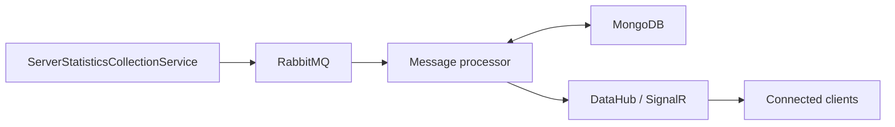

# Message Processing and Anomaly Detection Service

A .NET service that receives server statistics from RabbitMQ, stores readings in
MongoDB, and detects CPU and memory usage problems using configurable thresholds.
Alerts are broadcast to connected clients through a separate SignalR application,
DataHub.

## How it works



The solution contains two applications:

- **Message Processing and Anomaly Detection Service** runs a background worker
  that consumes JSON messages from the durable `server_statistics_queue`.
- **DataHub** exposes the `/alerts` SignalR hub and a `/health` endpoint.

For each message, the worker loads the latest stored reading for the same
`ServerIdentifier`, saves the new reading, and runs the CPU and memory evaluation
engines. Each engine checks for high usage and for an increase relative to the
previous reading. The worker sends the resulting alert list as a JSON string to
DataHub's `SendAlert` method, which broadcasts it as a `ReceiveAlert` event.
Clients deserialize the string into an array of objects with a `Message` field.
An empty array means no rules triggered.

Messages use the following structure. Memory values must use the same unit, and
the CPU threshold must use the same scale as the sender's `CpuUsage` value:

```json
{
  "MemoryUsage": 4096,
  "AvailableMemory": 4096,
  "CpuUsage": 45,
  "Timestamp": "2026-11-08T10:00:00Z",
  "ServerIdentifier": "server-01"
}
```

## Relationship with the sender project

This service processes readings published by
[ServerStatisticsCollectionService](https://github.com/none-empty/ServerStatisticsCollectionService).
The sender collects and publishes statistics; this repository handles storage,
evaluation, and alert delivery.

The sender's default Docker deployment hosts RabbitMQ as `rabbitmq:5672` on the
`serverstatisticscollectionservice_messaging` network, with `guest` / `guest`
credentials. Both projects declare the same durable `server_statistics_queue`.
This repository's processor joins that external network to reach the broker;
its Compose stack starts MongoDB and DataHub, while RabbitMQ belongs to the sender
deployment. Start the sender stack before this stack so the network exists.

If the sender uses a different Compose project name, set `RABBITMQ_NETWORK` to
the actual messaging network name. Match the `RabbitMQ__HostName`,
`RabbitMQ__UserName`, and `RabbitMQ__Password` settings to the sender's broker.
Inside Docker, `RabbitMQ__Port` is the broker's container port.

## Requirements

- **Docker deployment:** Docker Engine with the Docker Compose plugin, plus the
  running sender stack and its external messaging network. The Dockerfiles build
  both .NET applications, so a host .NET installation is unnecessary.
- **Local development:** a .NET SDK capable of targeting .NET 9, the .NET 9 and
  ASP.NET Core 9 runtimes, and reachable RabbitMQ and MongoDB instances. DataHub
  must also be running before the worker can process messages.

## Configuration

Copy `.env.example` to `.env` for Docker Compose. Compose reads that file and
passes its values into the containers. Connection settings use the .NET options
pattern, with double underscores separating sections and properties:

| Settings | Purpose |
| --- | --- |
| `MongoDB__ConnectionString`, `MongoDB__DataBaseName`, `MongoDB__CollectionName` | Statistics storage location. |
| `RabbitMQ__HostName`, `RabbitMQ__Port`, `RabbitMQ__UserName`, `RabbitMQ__Password` | Sender's RabbitMQ connection. |
| `RabbitMQ__BufferCapacity`, `RabbitMQ__PrefetchCount` | In-memory buffer size and broker prefetch count; both must be positive. |
| `SignalR__Url`, `SignalR__RemoteProcedureName` | DataHub connection; the method is `SendAlert`. |
| `RABBITMQ_NETWORK` | External Docker network shared with the sender. |
| `DATAHUB_PORT` | DataHub's published host port; defaults to `5198`. |

Evaluation settings bind from top-level configuration into `EvaluationParameters`,
which the evaluation manager receives through `IOptions<EvaluationParameters>`.
Their environment variable names remain unprefixed:

| Variable | Alert condition |
| --- | --- |
| `CpuUsageAnomalyThresholdPercentage` | Current CPU usage exceeds previous CPU usage multiplied by `1 + threshold`. |
| `MemoryUsageAnomalyThresholdPercentage` | Current memory usage exceeds previous memory usage multiplied by `1 + threshold`. |
| `CpuUsageThresholdPercentage` | CPU usage exceeds the threshold, using the sender's CPU scale. |
| `MemoryUsageThresholdPercentage` | `MemoryUsage / (MemoryUsage + AvailableMemory)` exceeds the threshold. |

An anomaly threshold of `0.2` means an increase greater than 20%; a memory usage
threshold of `0.85` means more than 85% used memory. For CPU readings on a 0–100
scale, a CPU usage threshold of `80` means usage above 80%. All four settings
default to zero, so set values appropriate for your workload. When a server has
no stored reading, its previous CPU and memory usage are treated as zero; positive
first readings therefore trigger the anomaly rules.

## Run with Docker Compose

First, run this command from the **sender repository**:

```bash
docker compose up --build -d --wait
```

Then, from **this repository's root**:

```bash
cp .env.example .env
# Edit .env for your broker connection, network, and evaluation thresholds.
docker compose up --build -d --wait
```

The processor starts after MongoDB and DataHub pass their health checks. It
retries initial SignalR and RabbitMQ connections when those services are
temporarily unavailable.

With the default configuration, clients connect to the SignalR hub at
`http://localhost:5198/alerts`. Check DataHub's health at
`http://localhost:5198/health`. Within the containers, the processor uses
`mongodb:27017`, `rabbitmq:5672`, and `http://datahub:8080/alerts`. MongoDB is
available inside the Compose network; RabbitMQ's published host ports are managed
by the sender deployment.

Inspect or stop this stack with:

```bash
docker compose ps
docker compose logs -f processor
docker compose down
```

MongoDB data persists in a named volume after `docker compose down`. After editing
`.env`, run `docker compose up -d` to recreate containers with the new settings.

## Run locally with .NET

Start the sender and make its RabbitMQ broker reachable from your host. Use its
published host port for the local worker. You also need a MongoDB instance; for
example, start a separate local development instance with:

```bash
docker run -d --name anomaly-mongodb -p 127.0.0.1:27017:27017 mongo:8.0
```

Restore and build the solution from this repository's root:

```bash
dotnet restore "Message Processing and Anomaly Detection Service.sln"
dotnet build "Message Processing and Anomaly Detection Service.sln" --no-restore
```

In one terminal, start DataHub using its HTTP profile:

```bash
dotnet run --project DataHub/DataHub.csproj --launch-profile http
```

In another terminal, set the worker's configuration and start it. These example
thresholds assume the sender reports CPU usage on a 0–100 scale:

```bash
export MongoDB__ConnectionString=mongodb://localhost:27017
export MongoDB__DataBaseName=server_statistics
export MongoDB__CollectionName=statistics
export RabbitMQ__HostName=localhost
export RabbitMQ__Port=5672
export RabbitMQ__UserName=guest
export RabbitMQ__Password=guest
export SignalR__Url=http://localhost:5198/alerts
export SignalR__RemoteProcedureName=SendAlert
export CpuUsageAnomalyThresholdPercentage=0.2
export MemoryUsageAnomalyThresholdPercentage=0.2
export CpuUsageThresholdPercentage=80
export MemoryUsageThresholdPercentage=0.85

dotnet run --project "Message Processing and Anomaly Detection Service/Message Processing and Anomaly Detection Service.csproj"
```

Adjust the broker port and credentials to match the sender. Local `dotnet run`
does not automatically load `.env`; export the settings in the worker's shell.
Once the sender publishes readings, the worker stores them and broadcasts the
evaluation results through DataHub.
